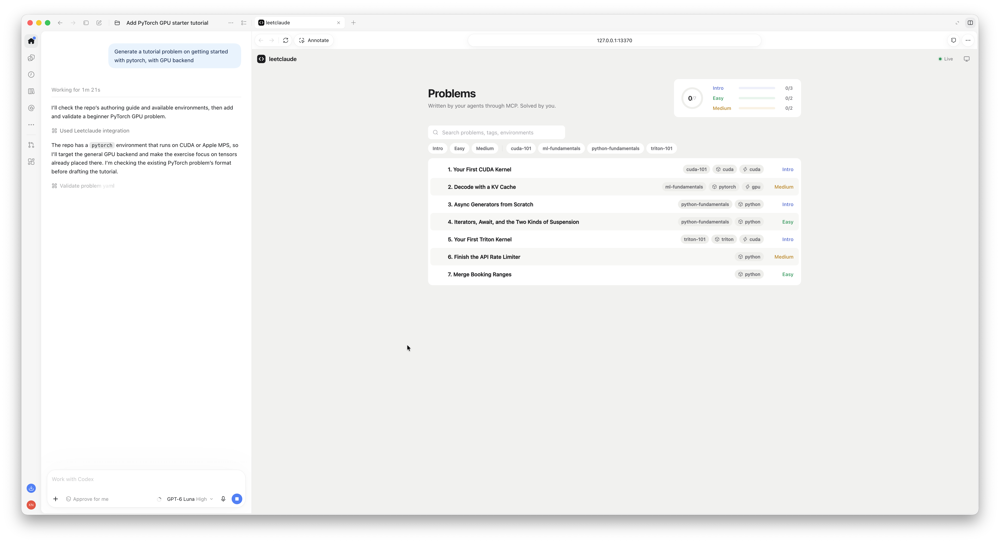
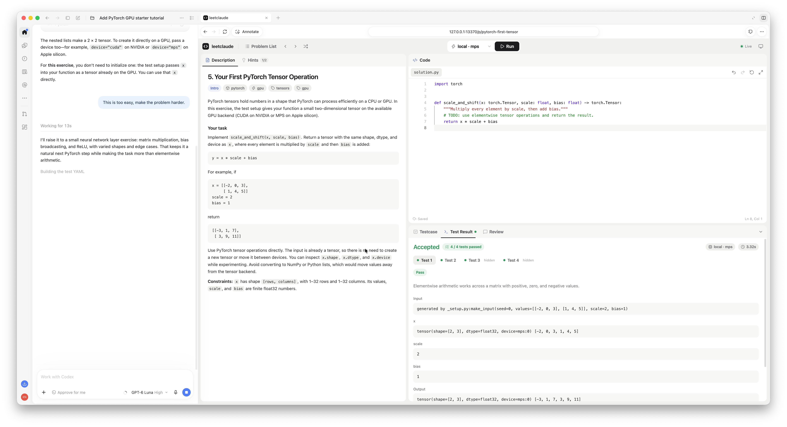
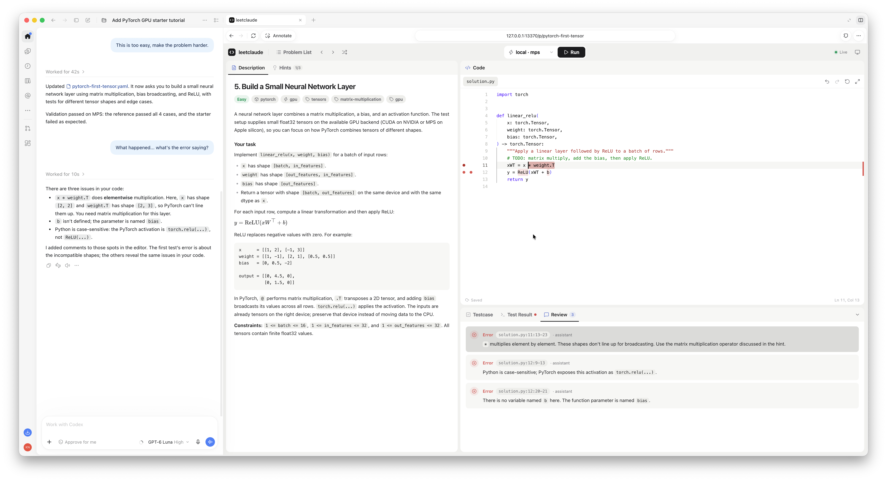
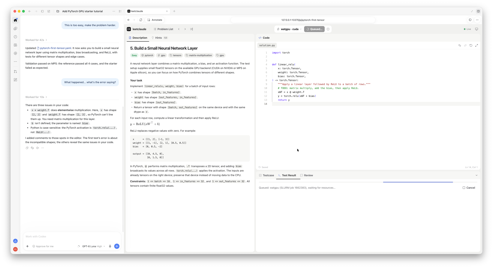

# leegen

A LeetCode-style programming trainer where **your coding agent writes the problems, and you
solve them**. Ask for an exercise on a topic you want to learn, work through it in the browser,
and ask the same agent for hints or feedback. Use the hosted browser edition to run Python and
WebGPU exercises in your browser, or run the server edition locally for native and remote
CPU and GPU execution.

There is no fixed problem bank: the repo includes examples, and your agent can create new
problems or adapt existing ones to your level. Exercises can cover algorithms, async Python,
multi-file services, WebGPU, PyTorch, Triton, or CUDA kernels.

## Choose an edition

Both editions use the same problem format, editor, test harness, and core validation rules.
Each lets an agent create problems, inspect your work, run tests, annotate code, and suggest
edits. They differ in where code runs, where work is stored, and how the agent connects:

| | Browser edition | Server edition |
| --- | --- | --- |
| Get started | [Open the hosted app](https://leegen.frankshan.workers.dev); no server installation | Run `make start` from a local checkout |
| Execution | Python in Pyodide; WGSL kernels through WebGPU | Native local CPU, Apple MPS, or CUDA; remote SSH and Slurm executors |
| Problems | Python and WebGPU; `function` and `pytest` judges | Python, C++, PyTorch, Triton, and CUDA; `function`, `pytest`, and `script` judges |
| Agent connection | WebMCP tools on the page in a supported browser, such as Codex's built-in browser | MCP server over HTTP, usable by Codex, Claude Code, and other MCP clients |
| Storage | Browser IndexedDB, scoped to the site and browser | YAML files in `problems/` and work in `workspace/` |
| Offline | Works offline after the required app and runtime files have been cached | Runs locally; remote execution needs a connection to the host |

The problem list marks exercises that need the other edition. Browser data is separate from
the server's files and from data at other site origins. Use the browser edition's export/import
or manual folder sync to transfer problems and work; see [browser edition storage](docs/browser.md#storage-export-and-import).

## How it works with your coding agent

leegen provides the browser editor and test runner. The server edition exposes an **MCP
(Model Context Protocol) server**; the browser edition exposes corresponding **WebMCP** site
tools to a supported browser. Your coding agent can use these tools to author exercises and
act as your tutor. You use your existing agent and chat; leegen itself does not require a
model API key.

The app makes your open problem, current code (including unsaved edits), cursor, and test
results available to the agent. The agent can read that context, run tests, leave comments on
exact code ranges, and propose edits that you accept or reject in the editor.
You can ask for help without copying your code and error messages into chat.

The four screenshots below follow one **server edition** PyTorch learning session in Codex.
Click any image to open the full-size screenshot stored in this repo.

### 1. Generate a problem through MCP

Ask your agent: **“Generate a tutorial problem on getting started with PyTorch, with a GPU
backend.”** The agent reads the authoring guide, checks available environments, and creates a
YAML problem containing the description, starter code, visible and hidden tests, and a
reference solution. The MCP authoring tools validate the exercise by checking that the
reference passes every test and the starter fails at least one, when a compatible executor
is available. The saved exercise appears in the problem list.

[](docs/images/problem-generation.png)

[Full-size screenshot: problem generation](docs/images/problem-generation.png)

### 2. Solve it and run real tests

Read the description on the left and write your solution in the editor on the right. The
Testcase and Test Result tabs let you inspect cases and their results. In this example, a
tensor scale-and-shift solution passes all four tests on the local Apple GPU (`local · mps`),
including two hidden cases. The result panel shows the input and output tensors, their
shapes, dtypes, and device.

Once it feels too easy, ask **“Make the problem harder.”** The agent can update the exercise,
including its description and tests; here it moves from elementwise arithmetic to a small
neural network layer with matrix multiplication, bias broadcasting, and ReLU.

[](docs/images/test-results.png)

[Full-size screenshot: test results](docs/images/test-results.png)

### 3. Get feedback directly on your code

Ask **“What’s the error saying?”** The agent calls `get_session` to inspect your current
attempt and failing tests, and can use `run_tests` to check its diagnosis. It leaves targeted
feedback with `annotate`, which appears as editor highlights and comments in the Review tab.
In this screenshot, the comments identify elementwise multiplication where matrix
multiplication is needed, an incorrect activation name, and an undefined variable.

For changes, `propose_edit` presents a diff for you to accept or reject. The tutoring protocol
asks agents to give hints in small steps and provide a complete solution only when requested.

[](docs/images/agent-comments.png)

[Full-size screenshot: agent comments](docs/images/agent-comments.png)

### 4. Execute on a remote GPU

Choose a compatible executor from the toolbar to run the same exercise elsewhere. Here the
selection changes from local MPS to `watgpu · cuda`, a remote NVIDIA GPU reached through SSH
and Slurm. The screenshot shows the job queued for cluster resources, with its Slurm job ID
and a cancel control. Once allocated, the remote executor runs the tests and returns the
results to the same UI.

The local executor detects CPU, Apple MPS, and NVIDIA CUDA capabilities. Remote `ssh` and
`slurm` executors are configured in `~/.config/leegen/executors.yaml` and use your existing
SSH authentication. Environments are provisioned with uv on first use and cached for later
runs. The toolbar offers executors compatible with the exercise’s hardware requirements;
PyTorch exercises can target either MPS or CUDA, while CUDA and Triton kernels require NVIDIA
hardware.

[](docs/images/remote-gpu.png)

[Full-size screenshot: remote GPU execution](docs/images/remote-gpu.png)

See [executor configuration](docs/executors.md) for SSH and Slurm setup, and
[the cluster setup guide](docs/clusters/README.md) for onboarding a remote backend.

## Quick start: browser edition

Open [leegen](https://leegen.frankshan.workers.dev) in a browser. Python exercises run in
Pyodide; WebGPU exercises also require a browser and device with WebGPU support. Open the
site in Codex's built-in browser to use its WebMCP tools with an agent. Your problems and work
are stored in that browser; export them or sync to a folder when you want to share them with
another browser or the server edition.

To build and serve the browser edition locally, see the [browser edition guide](docs/browser.md).

## Quick start: server edition

Requirements: [uv](https://docs.astral.sh/uv/) and Node.js with npm. From the repo root:

```bash
make start        # installs dependencies, builds the UI if needed, and starts the server
```

Open [http://127.0.0.1:13370](http://127.0.0.1:13370). One process serves the UI, REST API,
WebSocket updates, and MCP endpoint at `http://127.0.0.1:13370/mcp`. Keep it running while
using the app or its MCP tools. Use `make stop` from another terminal to stop it.

### Connect your agent

For **Codex**, register the local MCP server:

```bash
codex mcp add leegen --url http://127.0.0.1:13370/mcp
codex mcp get leegen
```

For **Claude Code**, the repo’s [`.mcp.json`](.mcp.json) already declares the server. To add
it manually from another project:

```bash
claude mcp add --transport http leegen http://127.0.0.1:13370/mcp
```

Other clients that support MCP over streamable HTTP can use the same URL. If your agent does
not show the newly configured tools, restart the client. Agent integration works with the app
in a regular browser; the screenshots show Codex’s browser beside its chat.

Then ask your agent to create a problem, or open one and ask for a hint. The repo’s
[`AGENTS.md`](AGENTS.md) explains the authoring and tutoring protocols.

## Under the hood

Each problem is a self-contained YAML file in `problems/`. It declares the exercise content,
editable and supporting files, tests, reference solution, environment, and hardware needs.
In the server edition, your saved solution and review state live in the gitignored
`workspace/<id>/` directory. The browser edition stores its copies in IndexedDB.

Both editions plan a job bundle and run the shared harness. The server writes the bundle to a
temporary directory and sends it to an executor; the browser runner builds it in Pyodide's
in-memory filesystem. The judge defines how the solution is tested, while the environment and
executor determine the available runtime and hardware. Both return the same result format to
the UI and agent tools.

| Layer | Supported options |
| --- | --- |
| Judges | `function` for input/output and method-call tests; `pytest` for async, stateful, and multi-file exercises; server-only `script` for custom harnesses and compiled programs |
| Environments | Python and WebGPU in the browser; Python, C++, PyTorch, Triton, and CUDA on the server |
| Execution | Pyodide and WebGPU in the browser; local CPU/MPS/CUDA, remote SSH hosts, and Slurm clusters on the server |
| Browser UI | Monaco editor, Markdown and math descriptions, hints, test cases and results, review comments, and proposed edits; light and dark themes |

## Development and documentation

`make dev` runs the backend with auto-reload and the Vite UI with hot reload at
[http://127.0.0.1:13371](http://127.0.0.1:13371). Ctrl-C stops both. Set `LEEGEN_PORT`
(default `13370`) or `LEEGEN_WEB_PORT` (default `13371`) to override the ports; update
your MCP URL if the backend port changes.

`make check` runs backend tests, problem validation, frontend conformance tests, and the frontend
build. `make smoke` checks a running server edition in Chrome. For the browser edition, run
`make browser`, `make browser-serve`, and then `make browser-smoke` in another terminal.

- [Agent manual and architecture](AGENTS.md)
- [Problem authoring guide](docs/authoring.md)
- [Browser edition: architecture, storage, and deployment](docs/browser.md)
- [Problem JSON Schema](schema/problem.schema.json)
- [Executor configuration](docs/executors.md)
- [Cluster setup guide](docs/clusters/README.md)
- [Screenshots](docs/images/)
